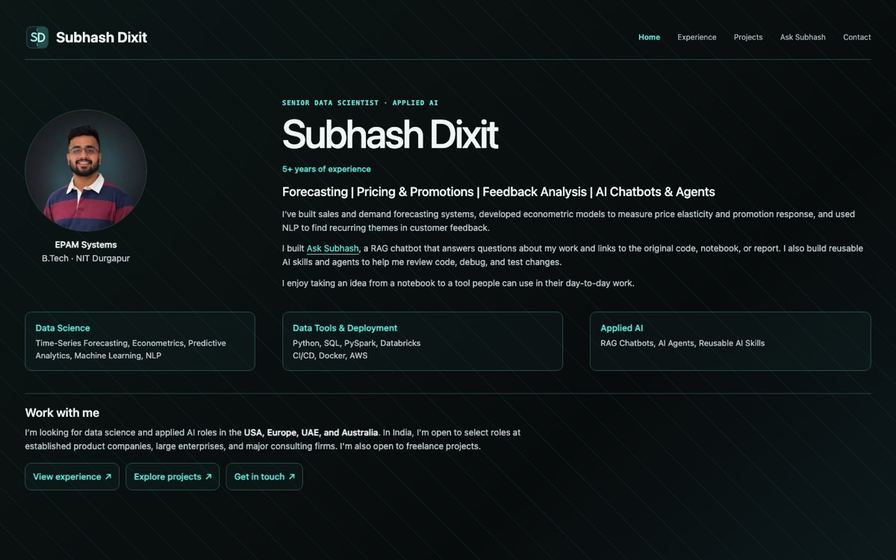
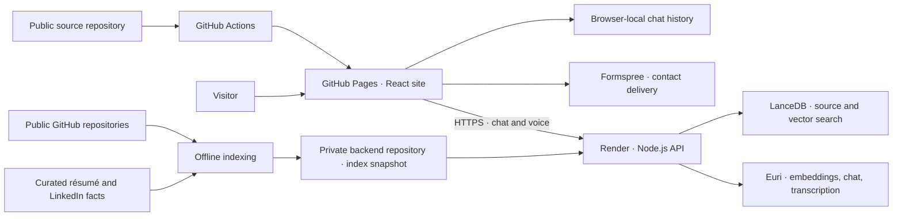

# Subhash Dixit | Data Science & Applied AI

[Portfolio](https://subhashdixit.github.io/) · [Experience](https://subhashdixit.github.io/#experience) · [Projects](https://subhashdixit.github.io/#projects) · [Ask Subhash](https://subhashdixit.github.io/#ai-lab)



## Overview

This portfolio brings together my professional experience, education, applied machine learning projects, and résumé. Ask Subhash lets visitors explore that work through questions and follow-ups. Its answers link to evidence such as a GitHub notebook, a source file, or the Experience page.

## Motivation and problem statement

A résumé can tell a recruiter that I worked on forecasting or built an NLP system. It takes much longer to find the exact notebook, understand the modelling choices, or see how a result was evaluated. This project gives visitors two ways to explore the same work. They can browse the portfolio and live demos, or ask a focused question and follow the cited sources.

## Architecture



### Application flow

1. React displays the portfolio and manages the chat UI, voice recording, and browser-local conversations. It sends the question and limited follow-up context to the Node API.
2. The API identifies relevant repositories and files, retrieves evidence with lexical and vector search, and ranks candidates. Verified portfolio facts can use a direct response.
3. Euri generates an answer using the retrieved evidence. The API returns the answer and source links. Voice goes through Euri transcription first, and the user can review the transcript or send it directly.
4. Contact submissions go to Formspree, with a confirmation displayed after the service acknowledges the submission.

## Data pipeline

| Stage | Implementation |
| --- | --- |
| Extract | Read public GitHub metadata and READMEs, inspect checked-out source files and notebook cells, and add curated profile facts. |
| Transform | Normalize text, filter sensitive file types and recognizable credential patterns, split eligible content into source records, and preserve URLs, file paths, and repository names. |
| Load | Build the catalog and full-text index in LanceDB. Add 1,024-dimensional vectors from `euri-embedding` for semantic retrieval. |
| Serve | Deploy the prebuilt snapshot to the API. Update it when the corpus changes. |

## Technology choices

| Technology | Role and reason |
| --- | --- |
| React, Vite, Tailwind CSS, Framer Motion | Responsive pages, chat state and interaction, and a static production bundle. |
| Node.js | Runs chat and transcription endpoints and keeps the provider key on the server. The production entry point uses Node's HTTP server. |
| LanceDB | Stores source records and vectors alongside the API. It supports full-text and semantic search without a separate database service. |
| Euri | `euri-embedding` embeds the corpus and queries, `euri-chat-smart` generates grounded answers, and `euri-transcription` converts voice input to text. |
| GitHub Actions and Pages | Verify and publish the static frontend so the site loads independently of API cold starts. |
| Render and Formspree | Render hosts the Node API. Formspree handles contact submissions. |

## Local development

Use Node.js 24 and npm.

```bash
npm ci
cp .env.example .env.local
npm run dev
```

Set `EURI_API_KEY` in `.env.local` to enable chat and transcription. The frontend uses same-origin API routes in local development. The prebuilt LanceDB snapshot supplies repository and notebook-level evidence. The snapshot is kept in the private API deployment repository.

### Rebuild the index

Use checkouts of the public repositories included in the corpus. The optional GitHub token raises GitHub API limits during indexing.

```bash
npm run index:portfolio
npm run index:portfolio:details -- /path/to/repository-checkouts
npm run embed:portfolio:details
```

The first command builds the repository catalog. The second extracts the detailed sources and builds the full-text index. The third fills missing embeddings. A snapshot should include both LanceDB directories under `server/data/` and the current `project-homepages.json`.

## Evaluation

Use questions with known evidence from the indexed sources. Check answer correctness and whether each claim is supported by the cited page or file. Review whether the response covers every part of a multi-topic prompt and handles a follow-up in the right repository. Report coverage and accuracy only for a defined set of questions and a specific index snapshot.

| Scenario | Expected behavior |
| --- | --- |
| “What did you build at EPAM?” | Gives the relevant work and cites the Experience page. |
| Ask about `credit-card-fraud-detector`, then ask how “that notebook” was evaluated | Resolves the follow-up to the notebook and reports supported metrics with a citation. |
| Ask about two projects in one prompt | Addresses both projects with supporting sources. |
| Ask for a childhood detail | Explains the portfolio's scope. |
| Record and send a voice question | Transcribes the question and submits it. Pausing lets the user review the text. |
| Open the site in a fresh browser profile | Shows an empty history. A returning browser can reopen or delete saved chats. |

The Pages workflow runs `npm run lint` and `npm run build`. Before sharing a new deployment, verify the tests above on the live site, check contact delivery to the inbox, and record cold and warm chatbot latency.

## Deployment

GitHub Pages serves the portfolio at [subhashdixit.github.io](https://subhashdixit.github.io/). GitHub Actions installs locked dependencies, runs lint and the Vite build, and publishes `dist/` on updates to `main`. The private API repository is deployed separately using the Render Blueprint.

| Setting | Where it is configured | Purpose |
| --- | --- | --- |
| `VITE_CHAT_API_URL` | GitHub Actions repository variable | Public Render origin for the chat and transcription endpoints. |
| `PORTFOLIO_ORIGIN` | Render Blueprint | Exact GitHub Pages origin allowed to call the API from a browser. |
| `EURI_API_KEY` | Render secret or local `.env.local` | Authenticates embedding, generation, and transcription requests. |

The public site stores up to 12 recent chats in the visitor’s browser profile. The API receives the question and limited context for follow-ups. Voice input is uploaded for transcription when a visitor records and submits a question.

### Backend on Render

1. Use the private `subhash-portfolio-api` repository with the backend, its shared `src/data` modules, dependency lockfile, and prebuilt LanceDB snapshot. Each backend update needs the matching versions of these files. Add the snapshot only to the private deployment repository.
2. In the [Render dashboard](https://dashboard.render.com/), choose **New → Blueprint**, grant Render access to the private repository, and select its `main` branch. `render.yaml` specifies the free Node web service, the allowed frontend origin, and `/healthz`. Set a fresh `EURI_API_KEY` in the Render dashboard.
3. Verify `GET /healthz` on the assigned Render URL. The server checks that the three required tables can open at startup. To exercise the actual chat route, send a JSON question with the portfolio origin header.

```bash
curl -fsS https://YOUR-API.onrender.com/api/ask \
  -H 'Origin: https://subhashdixit.github.io' \
  -H 'Content-Type: application/json' \
  --data '{"question":"What did you build at EPAM?"}'
```

### Frontend on GitHub Pages

1. In the public `subhashdixit.github.io` repository, choose **GitHub Actions** as the Pages source.
2. In **Settings → Secrets and variables → Actions → Variables**, set `VITE_CHAT_API_URL` to the assigned Render HTTPS origin.
3. Run **Verify and deploy GitHub Pages**. The deployed static bundle uses that origin for chat and voice requests. Open the live site and run the smoke checks above.

With the API URL unset, Ask Subhash displays “The chat service is being connected.” Once configured, Render free services can sleep after inactivity, so the first chat or transcription request can take longer. The portfolio and contact form remain reachable during that startup. API usage also depends on the Euri account quota.

## Repository layout

| Path | Purpose |
| --- | --- |
| `src/` | React views, portfolio copy, project metadata, and chat interface. |
| `server/` | Node API, provider client, retrieval, and portfolio knowledge. |
| `scripts/` | Repository ingestion and embedding commands. |
| `.github/workflows/pages.yml` | Frontend checks and publishing. |
| `render.yaml` | Render service configuration. |
